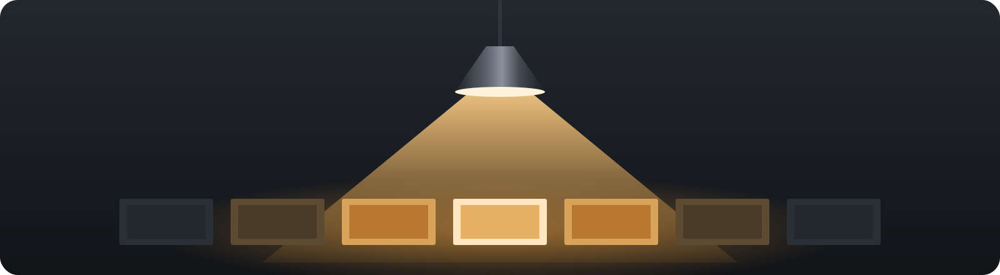

<p align="center"></p>

# Safelight for Lightroom Classic

[](https://m8ven.ai/mcp/chatelp-safelight-7dz4s4?s=readme)

Safelight lets Claude and other MCP clients work in your Adobe Lightroom Classic
catalog: inspect photos, edit Develop settings and masks, cull large shoots, write
metadata, organize collections and export, with Lightroom doing the actual work.

> **Status: pre-alpha.** It works from a development checkout (see
> [CONTRIBUTING.md](CONTRIBUTING.md)); there is no installer yet. The first public
> release (1.0) will ship as a signed macOS app.

Safelight is not affiliated with or endorsed by Adobe. Lightroom and Lightroom
Classic are trademarks of Adobe Inc.

## How it works

```
Claude Desktop ─┐
Claude Code ────┼─► MCP relay ─► Safelight hub ◄── Safelight plugin (inside Lightroom Classic)
Cursor, Codex ──┘     (stdio)    (localhost only)          ▲
                                         ▲            connects when Lightroom opens
                                         │ runs it
                                  Menu bar app: status, approvals, photos to check,
                                  preferences, setup
```

- The **menu bar app** is your control post. While it is open it runs the hub, shows
  what is connected and what the AI is doing, asks you to approve big or risky
  changes, lists the photos that need your eye, and holds your preferences. AI
  clients open it when they need it; without it installed, they start the hub alone.
- The **hub** runs on your Mac independently of Lightroom, so AI clients never fail
  because Lightroom is closed. It applies the safety rules: read-only mode, approval
  past a number of photos, always for deletions and file overwrites.
- The **Lightroom plugin** connects to the hub whenever Lightroom Classic is open,
  and runs every command through the Lightroom SDK. Safelight never edits the
  catalog file directly.
- Several AI clients can share the same Lightroom session.

Details: [docs/ARCHITECTURE.md](docs/ARCHITECTURE.md).

## What it does

- A connection that survives Lightroom being opened, closed or restarted.
- 27 tools covering Develop settings, masks, metadata, keywords, collections,
  snapshots, search, export, culling and straightening ([TOOLS.md](docs/TOOLS.md)).
- Photo previews and contact sheets the AI can look at.
- Your approval before bulk or risky changes, in the app or in the AI client.
- Large shoots: batch operations and long jobs with progress.
- Burst and duplicate grouping, quality checks (focus, exposure, horizon, empty
  borders) and catalog search.
- Straightening of architecture and exhibitions with Lightroom's Guided Upright, the
  AI choosing the guides by eye when the automatic lines are wrong.
- Know-how that every AI client gets without being told: recipes for common jobs,
  background guides, and your preferences (color for changed photos, snapshots, real
  lens names). Where each kind of knowledge goes is in
  [ARCHITECTURE.md](docs/ARCHITECTURE.md#where-knowledge-lives).

Still to come for 1.0: a signed and notarized `.dmg`. Lightroom Classic 14 or later,
macOS only.

## Repository layout

| Path | Contents |
|---|---|
| `src/safelight/` | Python package: MCP relay and hub; recipes and guides in `data/` |
| `plugin/Safelight.lrplugin/` | Lightroom Classic plugin (Lua) |
| `app/` | macOS menu bar app (SwiftUI) and design assets |
| `docs/` | Architecture, tools ([TOOLS.md](docs/TOOLS.md)), plugin commands ([PLUGIN_COMMANDS.md](docs/PLUGIN_COMMANDS.md)), Lightroom API map ([LIGHTROOM_API.md](docs/LIGHTROOM_API.md)), design ([DESIGN.md](docs/DESIGN.md)) |
| `scripts/` | Development helpers |
| `tests/` | Python tests |

## Development

See [CONTRIBUTING.md](CONTRIBUTING.md).

## Privacy

Safelight runs on your Mac, with no account and no telemetry. What its tools read goes to
the AI client that calls them. See [PRIVACY.md](PRIVACY.md).

## Credits

Safelight started as a fork of
[lightroom-classic-mcp](https://github.com/4xiomdev/lightroom-classic-mcp) by
4xiom, released under the MIT License. Its Lightroom SDK action code is the
starting point of Safelight's plugin; the transport, server and tooling are being
rewritten.

## License

MIT. See [LICENSE](LICENSE).
